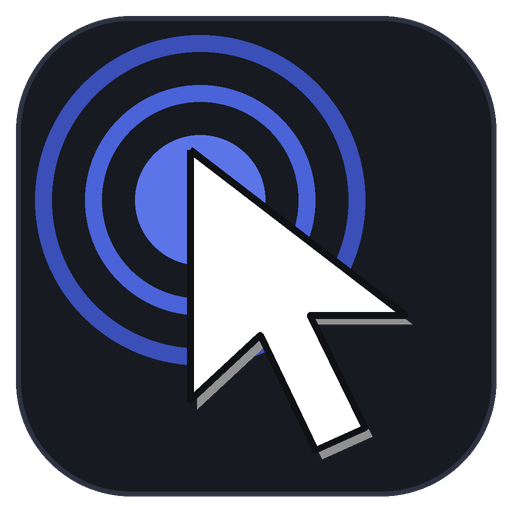

<div align="center">



# Auto Clicker

A lightweight, dark-mode auto clicker for Windows with a built-in **Minecraft Java hit mode** that times every swing to your weapon's attack cooldown.


**English** · [العربية](README.ar.md)

</div>

## Features

- **Action modes**: **Click** (repeated clicking) or **Hold** (continuous mouse hold for breaking blocks or AFK farming)
- **Mouse button**: left, middle or right
- **Interval** in milliseconds, with a **click limit** (`0` = unlimited) and **time limit in minutes** (`0` = unlimited)
- **Presets**: built-in and custom presets (*Sword*, *Mob Farm*, *Mining Hold*, *AFK Right-Click*) with one-click switching
- **Double click** & **random extra delay** options
- **Live counter & performance telemetry**: shows elapsed time, clicks/s, CPU usage (`%`), and post-run timing accuracy (average interval and max deviation in `ms`)
- **Macro location modes**: click at current **Cursor**, a **Fixed** point, or cycle through a **Sequence** of points recorded with `F8`
- **Audio feedback**: optional `winsound` beep on Start/Stop when the window is behind your game
- **Single-instance guard & High-DPI layout**: Windows Mutex prevents duplicate `F6` triggers, and scrollable High-DPI pages keep the **Start** button accessible at 150%+ scaling
- **System tray & update check**: optional minimize-to-tray and one-click GitHub Releases update check

## Download

Get the latest build from the **[Releases](../../releases/latest)** page:

| File | What it is |
|---|---|
| `AutoClicker-Setup-x.y.z.exe` | Installer (Start menu entry, optional desktop shortcut, uninstaller). No admin rights needed. |
| `AutoClicker-portable-x.y.z.exe` | Single file, no installation. |
| `SHA256SUMS.txt` | Checksums to verify your download. |

## Minecraft hit mode

In **Minecraft: Java Edition**, a weapon deals reduced damage (and no critical or sweep hits) unless its attack cooldown has fully recharged. Clicking faster than that just wastes swings.

Turn on **Minecraft hit** and pick your weapon or tool. Full charge takes `20 ÷ attack speed` game ticks (1 tick = 50 ms), rounded up to a whole tick plus a 10 ms safety margin:

| Weapon / Tool | Attack speed | Interval |
|---|---|---|
| Sword (all types) | 1.6 | 660 ms |
| Axe: wood / stone / copper | 0.8 | 1260 ms |
| Axe: iron | 0.9 | 1160 ms |
| Axe: gold / diamond / netherite | 1.0 | 1010 ms |
| Pickaxe (all types) | 1.2 | 860 ms |
| Shovel (all types) | 1.0 | 1010 ms |
| Hoe: wood / gold / copper | 1.0 | 1010 ms |
| Hoe: stone | 2.0 | 510 ms |
| Hoe: iron | 3.0 | 360 ms |
| Hoe: diamond / netherite | 4.0 | 260 ms |
| Trident | 1.1 | 960 ms |
| Spear | 1.2 | 860 ms |
| Mace | 0.6 | 1710 ms |
| Fist | 4.0 | 260 ms |
| Custom speed | User-defined | Calculated automatically |

### Minecraft & Server Disclaimer
- **Not an official Minecraft product:** This project is not affiliated with, endorsed by, or associated with **Mojang Studios** or **Microsoft**.
- **Fair Play & Multiplayer Warning:** Many multiplayer Minecraft servers forbid auto-clickers and macros. Using automated input on multiplayer servers may lead to an account ban. **Use entirely at your own risk.**

## Build & Test from Source

```powershell
git clone https://github.com/E7TRAF702/auto-clicker.git
cd auto-clicker
py -m pip install -r requirements.txt pytest ruff
py auto_clicker.py
```

- Run unit tests: `py -m unittest discover -s tests -v` (or `pytest -v`)
- Run timing benchmark: `py tools/benchmark.py`
- Build installer & portable exe: `build.bat` (reads `__version__` from `autoclicker/__init__.py` automatically)

## Code Signing Policy & Privacy

- Free code signing provided by [SignPath.io](https://signpath.io/), certificate by [SignPath Foundation](https://signpath.org/).
- **Committers, Reviewers, and Approvers:** [E7TRAF702](https://github.com/E7TRAF702).
- **Privacy Policy:** This program will not transfer any information to other networked systems unless specifically requested by the user (when clicking *Check for updates* in *Options* to query GitHub Releases).

## License

[MIT](LICENSE) · [Third-Party Notices](THIRD_PARTY_NOTICES.md)
